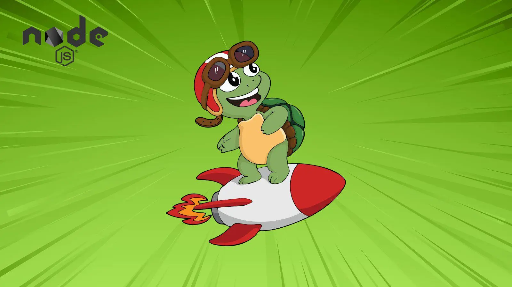

# Javascript Project

JavaScript (JS) is a programming language well-known as the scripting language for Web pages.

<table>
<thead>
  <tr>
    <th>JavaScript</th>
    <th>Capability</th>
  </tr>
</thead>
<tbody>
  <tr>
    <th></th>
    <th>Is an interpreted programming language</th>
  </tr>
  <tr>
    <th></th>
    <th>Can program both the frontend and the backend of a web application</th>
  </tr>
  <tr>
    <th></th>
    <th>Develop mobile applications</th>
  </tr>
  <tr>
    <th></th>
    <th>Develop  AI applications</th>
  </tr>
  
  <tr>
    <th></th>
    <th>Develop desktop applications</th>
  </tr>
  
  <tr>
    <th></th>
    <th>Develop embedded applications</th>
  </tr>
  
  <tr>
    <th></th>
    <th>Develop games and 3D applications</th>
  </tr>

</tbody>
</table>

Node (JS) Mascot: Rocket Turtle

